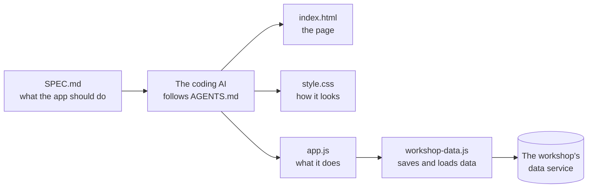

# How this app is made

You described your idea, the workshop's AI wrote it down as a spec, and a coding AI built the app
from it. Every file is plain HTML, CSS or JavaScript, so you can open any of them and read it.

## The files

| File | What it is |
| --- | --- |
| `index.html` | The page itself: its title, headings, buttons and text. The browser opens this file first. |
| `style.css` | How the page looks: colours, sizes and spacing, in light and dark mode, on a phone or a laptop. |
| `app.js` | What the page does when you tap or type: it reacts, changes the page and saves data. |
| `workshop-data.js` | A small helper that saves and loads the app's data on the workshop's data service. Everyone who opens the app shares the same data. |
| `SPEC.md` | The spec you approved: what the app should do. |
| `AGENTS.md` | The instructions the coding AI followed while building the app. |
| `README.md` | This file. |

## Where the app lives

The app is published at the workshop's address, under `/apps/` and your nickname. Before it goes
live, a check makes sure it holds only web files, uses nothing from other websites and stays under
5 MB.

## Good to know

- Anyone with the app's address can open it and change its data, so keep personal details out of it.
- Each change is saved as a commit in this repository, so you can see how the app grew step by step.
