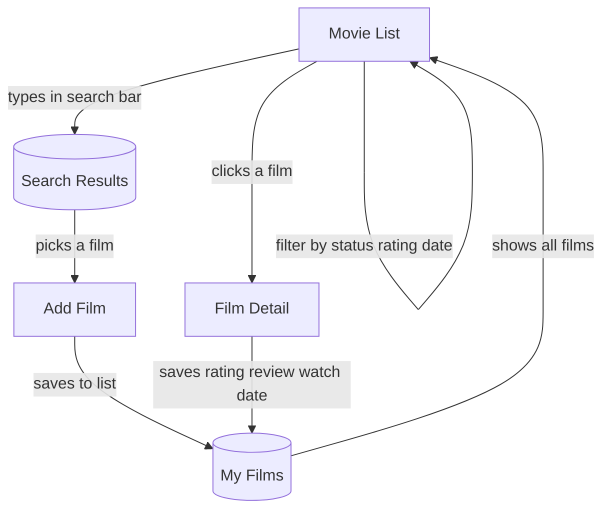

# Personal Movie Tracker

## What it does
This app is a personal movie tracker for one person. It has a single page with a live search bar at the top and your full film list below. As you type, matching films appear instantly so you can pick one and add it. You can filter your list by watched status, rating, and date added. Clicking any film opens its detail view where you can log or update your rating, review, and watch date. Movie posters and film details come from Wikipedia, and the app shows a friendly message if Wikipedia does not answer. The whole app has a cyberpunk visual style: dark background, neon accent colours, and a futuristic feel.

## Screens
- Movie List: the main page with a live search bar at the top that shows matching results with posters and titles from Wikipedia as you type, so you can pick a film without pressing any button. Below the search results sits your full list of films as cards with poster, title, rating, and review at a glance. Filter buttons let you show only watched or unwatched films, sort by rating, or sort by date added. The whole screen uses a cyberpunk style with neon colours and a dark background.
- Add Film: clicking one of the films shown in the live search directly adds that film to your list as unwatched, saving the title and poster.
- Film Detail: shows the full poster, title, your rating out of five stars, your written review, and the date you watched it. You can edit and save these details here.

## Data it keeps
- Film: title, poster image from Wikipedia, watched or unwatched status, star rating out of five, written review, date watched, date added to the list.