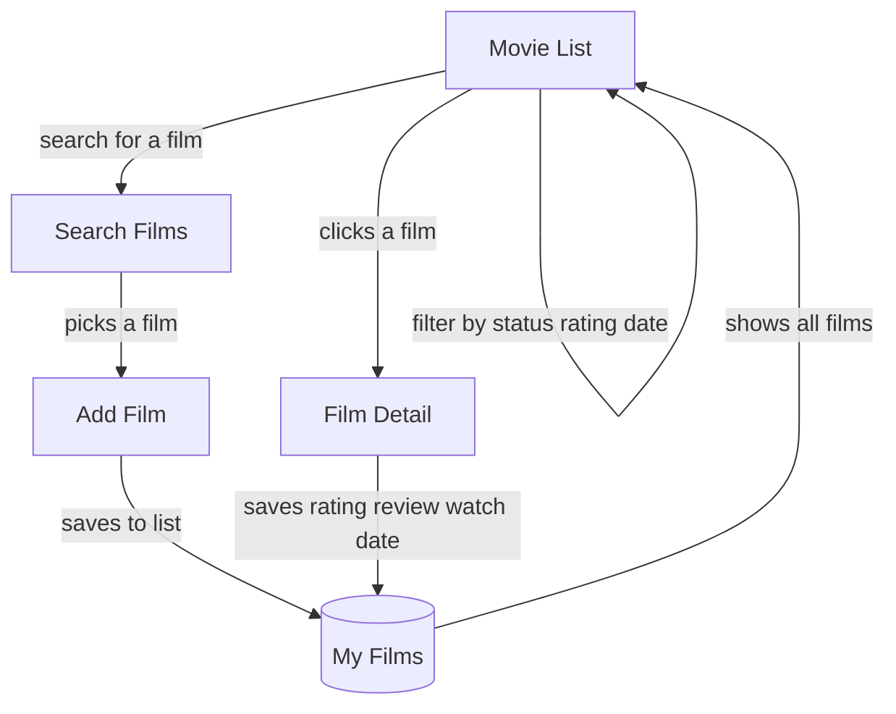

# Personal Movie Tracker

## What it does
This app is a personal movie tracker for one person. It keeps a single list of all films you have added, whether watched or not yet watched. You can filter the list by watched status, rating, and date added. Clicking any film opens its detail view where you can read your own review and log or update your rating, review, and watch date. Movie posters and film details come from Wikipedia, and the app shows a friendly message if Wikipedia does not answer.

## Screens
- Movie List: your full list of films shown as cards with poster, title, rating, and review at a glance. Filter buttons let you show only watched or unwatched films, sort by rating, or sort by date added.
- Search Films: a search bar where you type a film title and see matching results with posters and titles from Wikipedia, so you can pick the right one quickly.
- Add Film: confirms the film you picked and adds it to your list as unwatched, saving the title and poster.
- Film Detail: shows the full poster, title, your rating out of five stars, your written review, and the date you watched it. You can edit and save these details here.

## Data it keeps
- Film: title, poster image from Wikipedia, watched or unwatched status, star rating out of five, written review, date watched, date added to the list.